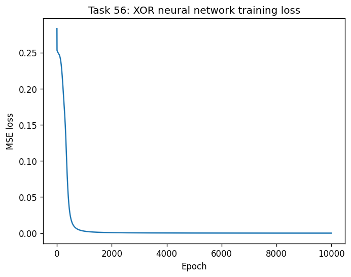
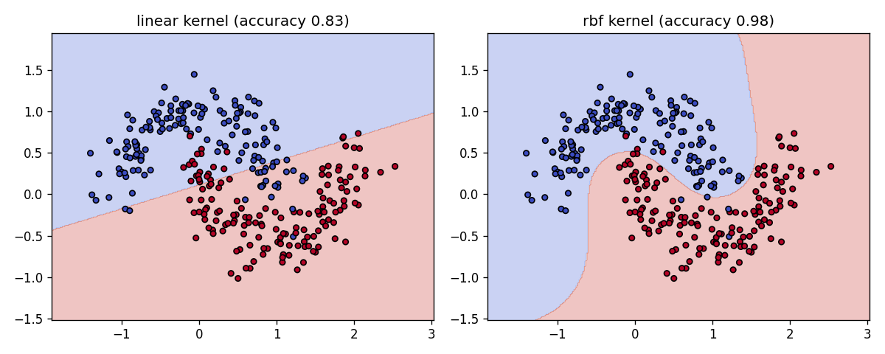
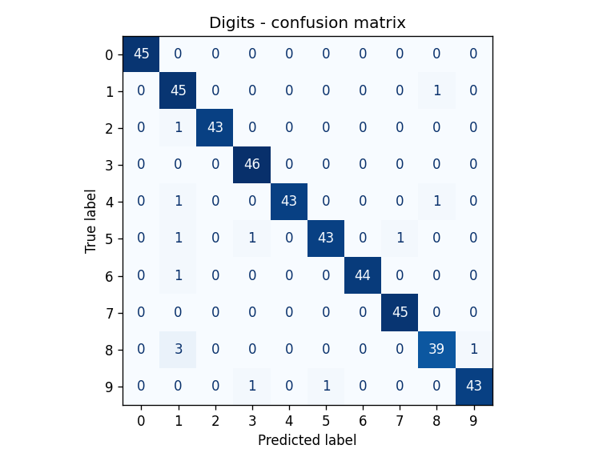

# AI / Machine Learning / Deep Learning: Hands-on Tasks (NAVTTC)

My solutions to the 65 practical tasks of the **NAVTTC "Artificial Intelligence, Machine Learning & Deep Learning"** course, completed at the NETSOL Institute of AI (2026). The tasks go from Python and data-analysis foundations to classical ML, neural networks, NLP and CNNs.

Each task folder has the script and its real captured output (`output.txt`). Plots are saved next to the script, or in `weeks-07-12/outputs/` for the later tasks.

| Neural network from scratch: training loss | SVM kernels on the moons dataset | Logistic regression on digits |
|---|---|---|
|  |  |  |

## Contents

### Foundations (weeks 1–4)
| Week | Tasks | Topic |
|---|---|---|
| 1 | 1–19, 21–25 | Environment setup, Linux commands, Python basics, conditionals, loops, data structures |
| 2 | 20, 26, 27, 49, 50 | Functions, exception handling, custom exceptions, mean/median/mode, standard deviation |
| 3 | 28–40 | NumPy: creation, indexing, slicing, dtypes, copy vs view, reshape, join/split, search, sort, random |
| 4 | 41–48 | Pandas: Series, DataFrames, CSV I/O, analysis, data cleaning, correlation heatmap |

### Machine learning (weeks 5–6)
| Task | Topic | Highlights |
|---|---|---|
| 51 | Linear regression | Simple and multiple regression, actual vs predicted plots |
| 52 | Logistic regression | Sigmoid, handwritten-digit classification, confusion matrix |
| 53 | Decision tree | Breast-cancer classification, cross-validation, tree visualisation |
| 54 | SVM | SVM kernels compared on non-linear (moons) data |
| 55 | Time-series analysis | 3 years of synthetic daily sales: trend, yearly and weekly seasonality |

### Deep learning & NLP (weeks 7–12)
| Task | File | Topic |
|---|---|---|
| 56 | `task56_neural_network_scratch.py` | 2-layer neural network written from scratch in NumPy that learns XOR (forward pass, backpropagation) |
| 57 | `task57_mlp.py` | Multi-layer perceptron with scikit-learn |
| 58 | `task58_feedforward_network.py` | Configurable feed-forward network in NumPy (ReLU, softmax and cross-entropy) on the digits dataset |
| 59 | `task59_loss_functions.py` | MSE, MAE, Huber, cross-entropy and other losses, implemented in NumPy and plotted |
| 60 | `task60_linguistics_nlp.py` | Tokenisation, stop words, stemming, POS tagging, NER |
| 61 | `task61_text_processing.py` | Text-cleaning pipeline: tokens, stop words, stemming, n-grams |
| 62 | `task62_text_analysis.py` | Bag-of-Words, TF-IDF, cosine document similarity and a sentiment classifier |
| 63 | `task63_cnn_demonstration.py` | Convolution with edge-detection kernels, ReLU and max pooling, written from scratch in NumPy |
| 64 | `task64_cnn_cifar10.py` | CNN image classifier on CIFAR-10 with TensorFlow/Keras |
| 65 | `task65_azure_ai_notes.md` | Microsoft Azure AI Services study notes |

## Run
```bash
pip install -r requirements.txt
cd weeks-01-06/Week5/Task52 && python logistic_regression.py
python weeks-07-12/task56_neural_network_scratch.py
```
Datasets are either generated in code or bundled with scikit-learn, so most scripts run offline. Task 64 downloads CIFAR-10 and needs TensorFlow. Task 2 is a bash script, so run it on Linux, WSL or macOS.

## Tech
Python · NumPy · pandas · Matplotlib · scikit-learn · NLTK · TensorFlow/Keras
